# Hướng dẫn quản trị website Velis Realty

Cho người sửa nội dung hằng ngày, không cần lập trình. Mọi việc dưới đây làm trong **wp-admin**
(`/wp-admin/`). Ảnh chụp lấy từ staging ngày 11/11/2026 khi thử bằng tài khoản vai trò **Biên tập viên**.

## Ai làm được gì

| Việc | Biên tập viên | Quản trị viên |
|---|---|---|
| Thêm / sửa bài viết, dự án, phân khu, dòng thấp tầng, chủ đầu tư, trang | ✓ | ✓ |
| Tải ảnh lên Media, đặt tiêu điểm ảnh, ảnh đại diện (logo chủ đầu tư) | ✓ | ✓ |
| Thêm chuyên mục (cụm bài) | ✓ | ✓ |
| **Cài đặt Velis** (trang chủ, số điện thoại, mạng xã hội, ảnh hero…) | ✓ | ✓ |
| Sửa **menu** (Giao diện → Menu) | ✗ | ✓ |
| Cài / cập nhật theme, plugin; quản lý tài khoản; cài đặt Rank Math chung | ✗ | ✓ |

Không cần sửa mã ở bất kỳ bước nào. Không dùng "Trình sửa tệp giao diện / plugin".

## 1. Thêm bài viết

1. **Bài viết → Viết bài mới**. Nhập tiêu đề, nội dung (dùng khối Tiêu đề H2/H3, Đoạn văn, Ảnh).
2. Cột phải: **Chuyên mục** = cụm bài của dự án (ví dụ *The Global City*). Cụm là chuyên mục có **đường dẫn (slug) trùng
   đường dẫn dự án**; dự án mới chưa có cụm thì tạo ở **Bài viết → Chuyên mục** (tên = tên dự án, slug = slug dự án).
   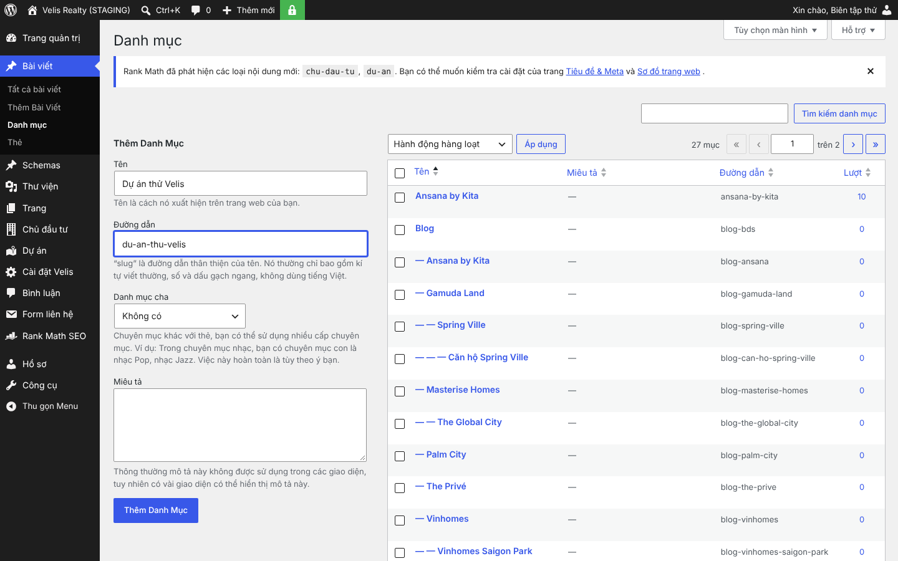
3. **Ảnh đại diện**: chọn từ Media. Hộp **Dự án / phân khu liên quan → Bài viết nói về**: tick dự án / phân khu bài nói tới
   (bài sẽ hiện ở trang dự án đó). Ô **Ảnh đại diện là**: chọn "Ảnh dự án (phối cảnh / công trình)" nếu đúng là ảnh dự án (trang chủ chỉ lấy bài có ảnh dự án).
   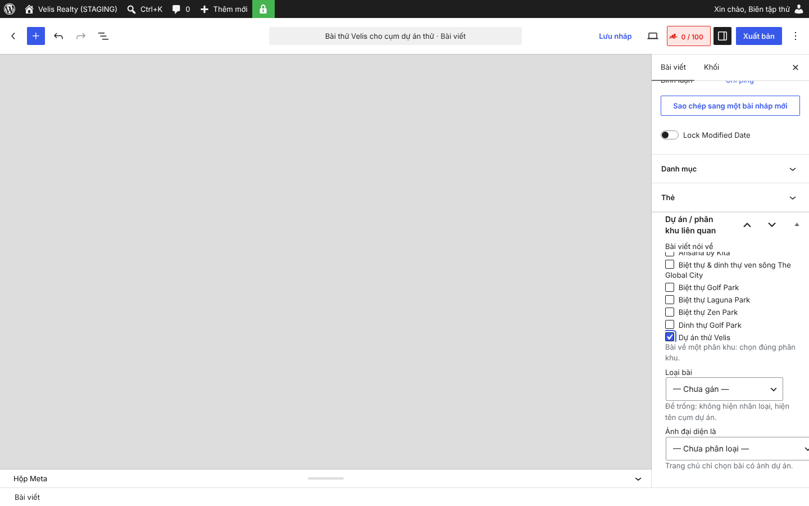
4. **Xuất bản**. Bài hiện ở /blog/, trang cụm `/blog/{cụm}/` và trang dự án.

## 2. Thêm dự án, phân khu, dòng thấp tầng

1. **Dự án → Thêm dự án / phân khu**. Nhập tên, đoạn mô tả, **Ảnh đại diện** (ảnh dùng ở thẻ dự án, dải nổi bật).
2. Hộp **Cấp & trạng thái**: chọn **Cấp** – *Dự án độc lập*, *Đại đô thị*, *Phân khu* hoặc *Dòng thấp tầng*;
   chọn **Trạng thái bán**; tick **Nổi bật** nếu muốn lên dải "Dự án nổi bật" ở trang chủ.
   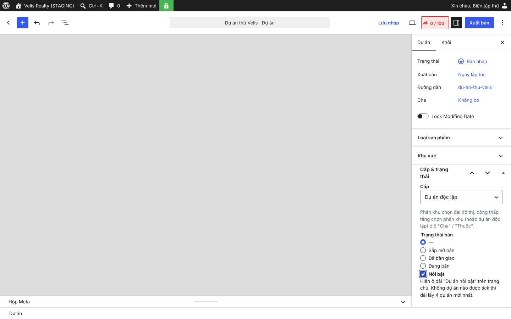
3. Phân khu / dòng thấp tầng: cột phải **Cha** = dự án (đại đô thị) hoặc phân khu chứa nó. Đường dẫn tự thành
   `/du-an/{dự-án}/{phân-khu}/`.
   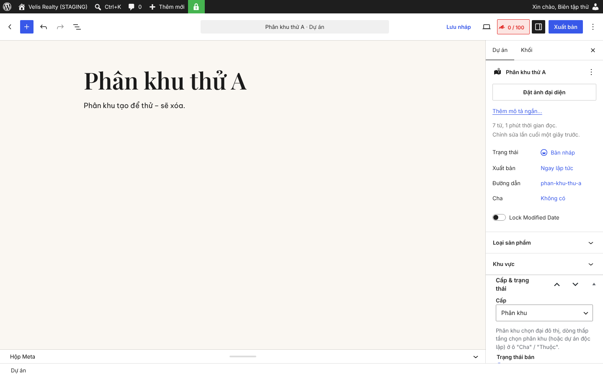
4. Điền hộp **Thông tin dự án** (chủ đầu tư, địa chỉ, quy mô, giá có nguồn…). Trang thiếu dữ liệu tối thiểu tự để
   *noindex* và báo "Đang noindex tạm thời – thiếu: …" trong hộp Cấp; điền đủ thì tự được index.
5. **Xuất bản**. Dự án mới hiện ngay ở: dải nổi bật (nếu tick), lưới "Dự án Velis đang tư vấn" trang chủ, /du-an/,
   menu "Dự án", trang chủ đầu tư, tìm kiếm.

## 3. Dự án nổi bật và thứ tự

- **Nổi bật**: tick / bỏ tick ô **Nổi bật** trong hộp Cấp & trạng thái rồi **Cập nhật**. Không dự án nào được tick
  thì dải lấy 4 dự án mới nhất.
- **Thứ tự** ở mọi nơi = **mới nhất trước theo ngày đăng**. Muốn đưa một dự án lên trước / xuống sau: cột phải
  **Xuất bản** → bấm ngày → đổi ngày đăng → **Cập nhật**. Danh sách dự án trong wp-admin xếp theo ngày để dễ soát:
  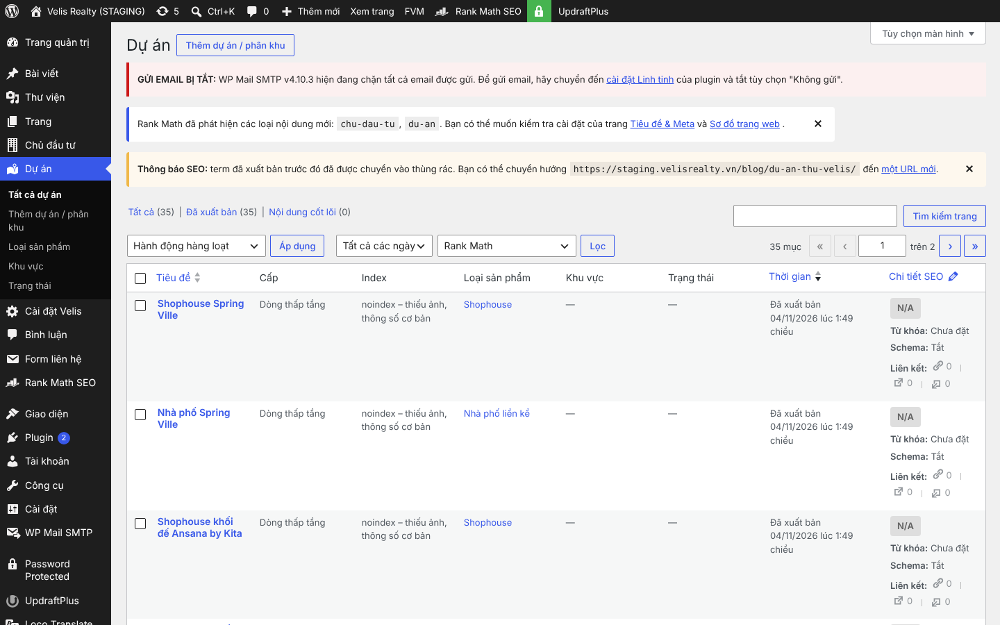

## 4. Cài đặt Velis: trang chủ, ảnh hero, số điện thoại

Menu trái **Cài đặt Velis**. Sửa ô cần đổi → **Lưu cài đặt** ở cuối trang. Ô để trống = dùng chữ mặc định
(đúng nội dung đang hiện); riêng **mạng xã hội** để trống thì ẩn biểu tượng.

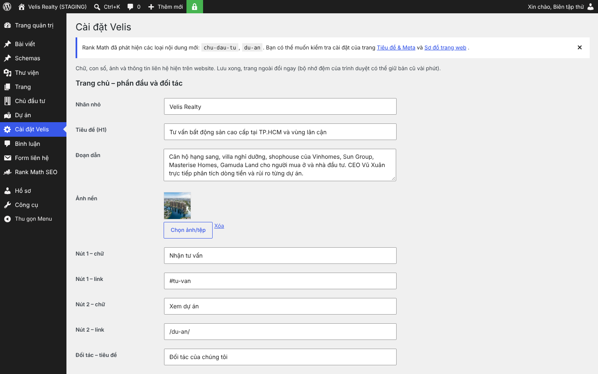

| Nhóm | Gồm |
|---|---|
| Trang chủ – phần đầu và đối tác | nhãn, tiêu đề H1, đoạn dẫn, **ảnh nền hero**, 2 nút (chữ + link), tiêu đề + mô tả khối đối tác |
| Trang chủ – 4 con số | số + nhãn từng ô |
| Trang chủ – khối Công ty Velis Realty | nhãn, tiêu đề, 2 đoạn, nút, 4 giá trị (tiêu đề + đoạn) |
| Trang chủ – Thi thử và Tuyển dụng | tiêu đề, câu, chữ nút, link |
| Trang Dự án, Chủ đầu tư, Blog, Giới thiệu | ảnh hero từng trang |
| Liên hệ, CEO, chân trang | **số điện thoại**, Zalo, email, địa chỉ, giờ làm việc, câu vai trò ("{chủ đầu tư}" tự thay bằng tên), CEO (tên, chức danh, ảnh), câu chân trang |
| Mạng xã hội | link từng mạng |

- **Đổi ảnh hero**: bấm **Chọn ảnh/tệp** cạnh ô ảnh → chọn trong Media → Lưu.
  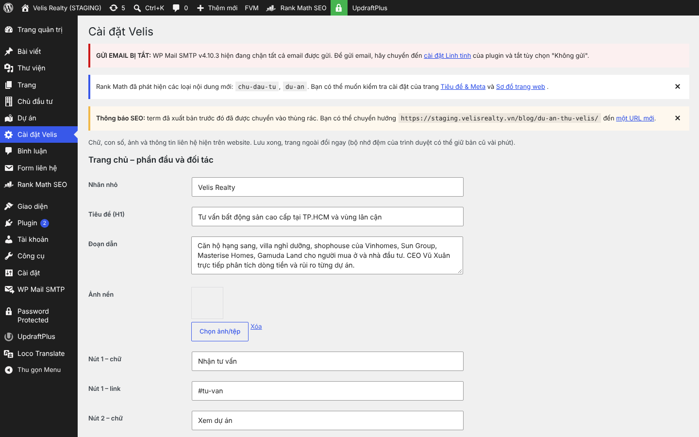
  Ảnh mới nên đặt **Tiêu điểm** (mục 6) để khung cắt giữ đúng phần quan trọng.
- **Đổi số điện thoại**: sửa ô **Số điện thoại** (viết có dấu cách như `0911 237 979`; link gọi tự bỏ dấu cách) và
  ô **Zalo** → Lưu. Số mới hiện ngay ở header, menu điện thoại, thanh gọi dưới màn hình điện thoại, khối form,
  chân trang, khối "Velis tư vấn", trang Liên hệ.
  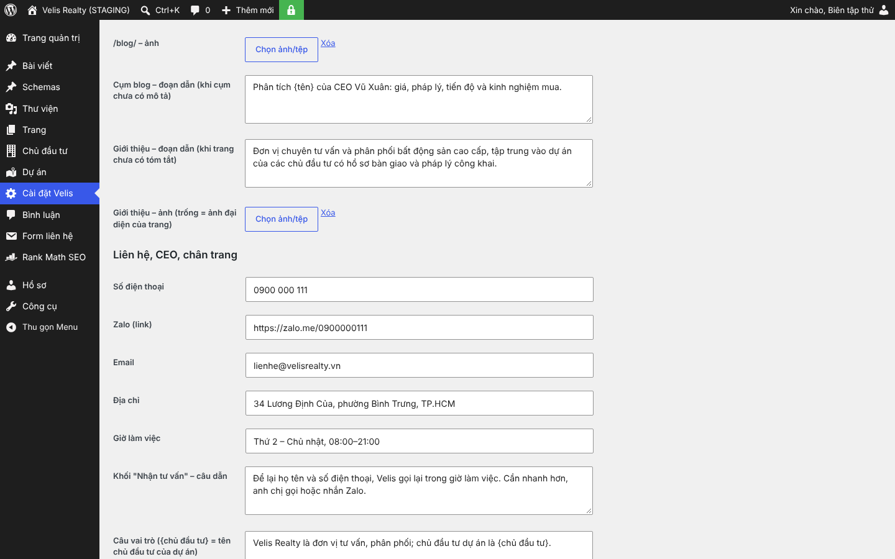
- **Đổi con số trang chủ**: nhóm **Trang chủ – 4 con số**, sửa số hoặc nhãn của ô cần đổi → Lưu.
  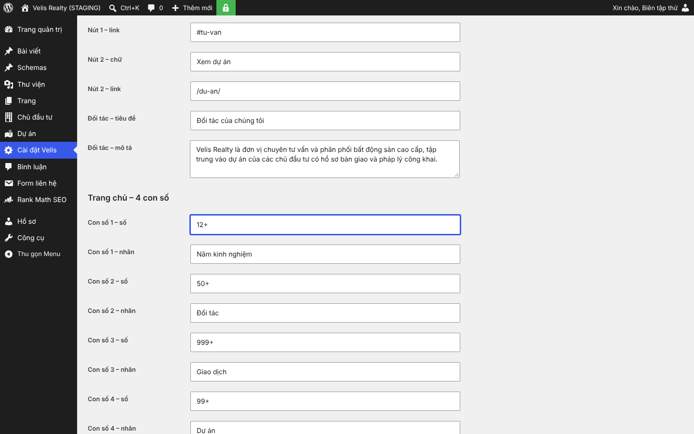

## 5. Logo chủ đầu tư (khối Đối tác trang chủ)

**Chủ đầu tư → (chọn) → Ảnh đại diện** = logo (PNG/WebP nền trong suốt, đã cắt sát logo). Khối "Đối tác của chúng tôi"
tự lấy logo của mọi chủ đầu tư có ảnh đại diện và chia đều ô, cân diện tích. Chủ đầu tư mới: **Chủ đầu tư → Thêm**.

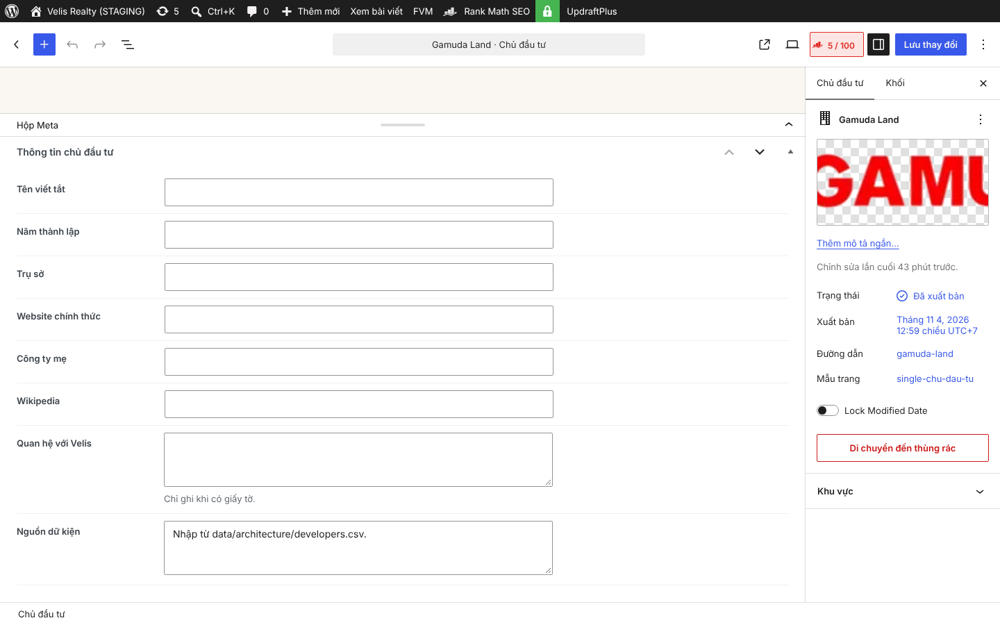

## 6. Tiêu điểm ảnh, dấu trên ảnh

**Media → (chọn ảnh) → Sửa chi tiết**:

- **Tiêu điểm**: phần ảnh giữ lại khi khung cắt (Giữa, Trên trái… 9 vị trí).
- **Dấu trên ảnh**: ảnh có logo / chữ in của chủ đầu tư thì chọn đúng loại – site tự phóng cắt hoặc không dùng ảnh đó
  ở hero / thẻ.
- **Bản gốc hỏng**: tick khi tệp gốc không mở được (site chỉ dùng bản thu nhỏ).

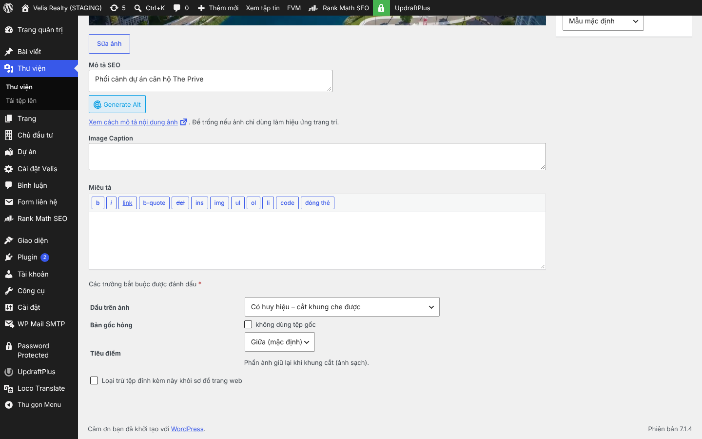

## 7. Sửa menu (cần Quản trị viên)

**Giao diện → Menu**. Hai menu đang dùng: **Velis – Menu chính** (vị trí *Menu chính*) và **Velis – Chân trang Khám phá**
(vị trí *Khám phá*). Kéo thả để đổi thứ tự, kéo mục sang phải để thành mục con (menu thả xuống). Mục **Dự án** tự có
danh sách dự án (mới nhất trước) + "Tất cả dự án" – không cần thêm tay. Bỏ gán menu thì header về cấu trúc mặc định.

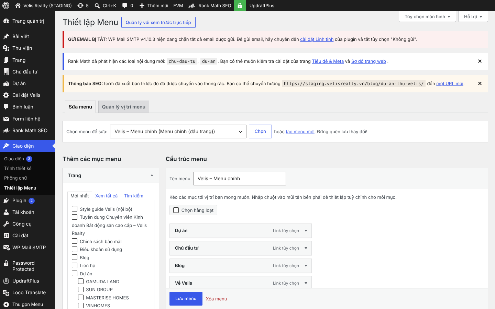

## Kết quả thử bằng tài khoản Biên tập viên (staging, 11/11/2026)

Tạo 1 dự án có ảnh + Nổi bật, 1 phân khu, 1 cụm, 1 bài; đổi số điện thoại và 1 con số – tất cả hiện đúng chỗ
(ảnh `screenshots/hoan-thien/bien-tap/`, bảng ở `docs/reports/hoan-thien-theme.md` mục 9). Dữ liệu thử đã xóa,
Cài đặt Velis đã trả về như cũ.
